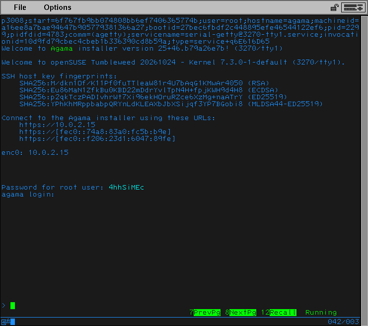

# Testing in emulators

Sometimes you need to test installation on a different architecture or you need
to test it with special hardware like multipath.

> [!NOTE]
> Emulating a different system architecture is very slow, booting the Agama
> installer might take 5-10 minutes, on slow hardware even more.
>
> If the boot is too slow and you see systemd timeout errors during boot then
> you can increase the default timeout value with boot option
> `systemd.default_timeout_start_sec=300` (the value is in seconds, 300s =
> 5minutes). On really slow systems you might use even more.

This repository contains several helper scripts to run the Qemu emulator. They
are supposed to be used as a template. Qemu has a lot of options, feel free to
edit the scripts according to your needs.

## Aarch64 emulator

To run an aarch64 system on x86_64 in Qemu first install these packages:

```sh
sudo zypper install qemu-arm qemu-uefi-aarch64
```

Then run the helper script in this directory, pass the path to the ISO as a
script argument:

```sh
./qemu-aarch64.sh agama.iso
```

The script configures some virtualized hardware, feel free to adapt it to your
needs.

During boot you can switch to the serial output to see the boot progress (`View
-> serial0` menu or `Ctrl+Alt+3` keyboard shortcut).

The script uses user network with forwarding the HTTPS port 443 to the local
port 44443. To connect to the Agama running in the VM open the
`https://localhost:44443` URL in the host.

## S390x emulator

This is similar to the aarch64 case above, to run an s390x system on x86_64 in
Qemu first install these packages:

```sh
sudo zypper install qemu-s390x
```

> [!NOTE] The Qemu emulation does not emulate the mainframe hardware in 100%
> compatible way and also the boot process is different. For example Qemu can
> boot from a virtual CD/DVD drive, that is not possible with a real mainframe.

Then run the helper script in this directory, pass the path to the ISO as a
script argument:

```sh
./qemu-s390x.sh agama.iso
```

In this case the boot progress is displayed directly in the terminal. To quit
the emulator use the `Ctrl+A X` shortcut.

The script uses user network with forwarding the HTTPS port 443 to the local
port 44443. To connect to the Agama running in the VM open the
`https://localhost:44443` URL in the host.

### Emulating the IBM 3270 terminal

The [IBM 3270 termina](https://en.wikipedia.org/wiki/IBM_3270) is quite
different to usual Unix terminals like VT-100 or serial consoles. You can test
your application with this special terminal using the Qemu emulation as well.



First you need to additionally install the 3270 terminal emulator:

```sh
sudo zypper install x3270
```

Then start the Qemu emulator with a different script which configures a virtual
3270 device:

```sh
./qemu-s390x-x3270.sh agama.iso
```

Then start the 3270 terminal emulator (the port is hardcoded in the script, you
can change it if needed):

```sh
x3270 -codepage CP037 localhost:2300
```

Log into the booted system and run this command:

```sh
systemctl start serial-getty@3270-tty1.service
```

This will start the login process in the 3270 terminal emulator.

To quit the emulator use the `Ctrl+A X` shortcut in the Qemu serial output
console.

## Emulating multipath storage

There are few important things when emulating a multipath device in Qemu:

- The disk image for the multipath device must be in RAW format (not QCOW2, VDI
  or anything else).
- Configure two (or more) disk controllers which use the same disk image file
  with shared RW access as the backend.
- The controllers must report the same device serial number and the same WWN for
  the multipath disk.

To run a system with one mulipath device (with two separate access paths) use
the helper script:

```sh
./qemu-x86_64-multipath.sh agama.iso
```
